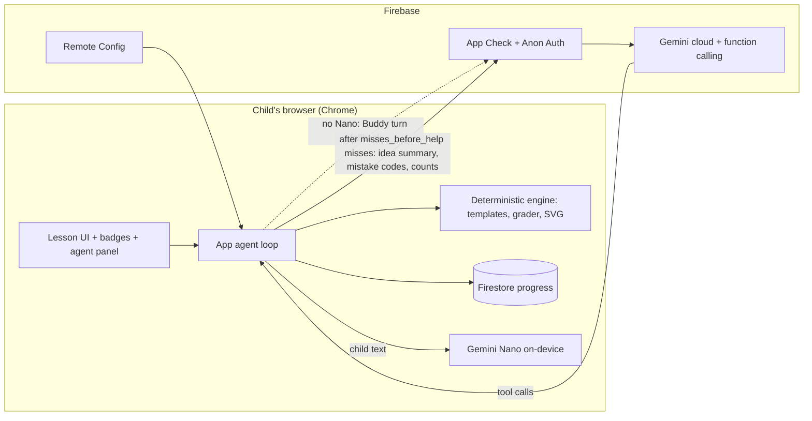
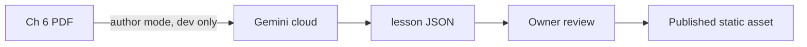

# Syllabus Buddy

A private, on-device-first maths tutor for one NCERT chapter: *Ganita Prakash* Grade 6, Chapter 6, *Perimeter and Area*.

## What it is and why

Syllabus Buddy teaches a 12-year-old one idea at a time, checks each idea with a question, and helps when the child gets stuck. When Gemini Nano is ready in Chrome, quick help runs on the child's own computer, so it is fast, free, works offline and keeps the child's answers on the device. On a computer without Nano, quick help falls back to the cloud and sends the child's answer (see [Privacy](#privacy)). When the child is really stuck, a cloud tutor takes over, and it gets an anonymised summary of the mistakes, never what the child typed.

Privacy is the reason the app is hybrid. The child uses a nickname and never logs in. Progress is tied to the browser's anonymous account, unless a parent chooses to sign in with Google to keep it across devices.

## Features

- **Guided lesson.** Seven ideas in book order, each with key points, a worked example and a labelled diagram. **Next** unlocks only after a correct answer; **Back** always works.
- **Fresh numbers.** Every question, answer key, worked step and diagram label is made by code from templates, so the numbers always match. The AI never invents numbers.
- **Buddy.** A wrong answer gets a short clue. Each clue carries a 🔒 (on-device) or ☁️ (cloud) badge.
- **Tutor agent.** After 2 misses on a question (tunable), a cloud agent explains the question first, then picks its own tools (diagram, practice question, worked solution, navigation) until the child gets it right or runs out of turns. If the child is still stuck after a session, **Ask the Tutor again** starts a new one. A "What the AI did" panel shows the exact summary it was sent and every tool call in order.
- **Weak-spot test.** 10 questions with new numbers each time, weighted toward the child's mistakes, with a timer per question difficulty. Wrong answers show the correct answer, worked steps and a **Why?** button.
- **Buddy's brain status.** The start screen shows whether Buddy is on-device, downloading, or using the cloud, with a **Get on-device Buddy** button when Nano can be downloaded.
- **Nickname and saved progress.** One child per browser. The child picks a nickname on the first visit, and after that the app opens straight into their lesson. Progress, mistakes and test history are saved in Cloud Firestore under the browser's anonymous account, with IndexedDB as a fallback when Firebase is unavailable.
- **Keep progress across devices.** In **For parents**, on the start screen or in the panel, a parent can sign in with Google. The browser's anonymous account is linked to Google, so all progress is kept and the child's progress opens on any computer signed in to that Google account. If that Google account already has a child, that child's progress is used; otherwise the child from this browser is copied across.- **Delete data.** **For parents** has a button to delete a child's data.
- **Read aloud.** A speaker button reads the lesson and clues with the browser's built-in speech.
- **For parents.** A panel lists the child's most common mistakes in plain language, every answer they have given, newest first, with the date, the question and what went wrong (10 at first, then 20 more at a time), and every finished test with its date, score and each question with the child's answer, with a short note written on-device when Nano is available.
- **Remote tuning.** Turn limits, the help threshold, test timers and the inference mode can be changed in Remote Config without a redeploy.

## How hybrid AI is used

Every AI call goes through Firebase AI Logic (`firebase/ai`), protected by App Check (reCAPTCHA Enterprise) and Anonymous Auth.

| AI feature | Where it runs | Model | What data it sees |
|---|---|---|---|
| Buddy turns (clue after a miss, test **Why?**) | On-device first (`prefer_on_device`), cloud fallback when Nano is missing | Gemini Nano; cloud fallback `gemini-3.5-flash-lite` (`VITE_CLOUD_MODEL`) | The idea, the question, and the child's answer. Returns structured JSON: intent, mistake code, clue. |
| Parent summary | On-device only | Gemini Nano | Top mistake descriptions and recent test scores. Without Nano the panel shows the list without the written note. |
| Tutor agent | Cloud only, with function calling | `gemini-3.8-flash` (`VITE_TUTOR_MODEL`) | Idea title and key points, question template and difficulty, miss count, mistake codes, mistake history counts and max turns. For each practice question: the question prompt and whether the answer was right, with the reason and mistake code. Never the child's text or nickname. Off in `only_on_device` mode. |
| Author mode | Cloud only, local dev build only | `gemini-3.8-flash` (`VITE_AUTHOR_MODEL`) | The chapter PDF, uploaded by the owner. Turns it into the lesson JSON the owner reviews and saves. Not in the hosted app. |
| Remote Config | Firebase | None | Supplies `inference_mode`, `max_turns`, `misses_before_help` and the test timers on app load. |

The inference mode (`prefer_on_device`, `only_on_device`, `only_in_cloud` or `prefer_in_cloud`) comes from Remote Config, falling back to `VITE_INFERENCE_MODE`. The Remote Config keys are optional and every one has a safe default in code, but switching the mode without a redeploy needs them published. A published `inference_mode` overrides `VITE_INFERENCE_MODE`.

## Architecture

## Privacy

- **Saved progress:** the nickname, progress, saved mistake history and test scores are stored in Cloud Firestore under the browser's account. The security rules let only that account read or write them. Without a Google sign-in, they are tied to this one browser. If Firebase is unavailable, the app falls back to IndexedDB on the device.
- **Deleting data:** a parent can delete a child's data from **For parents**. It is removed from Firestore, or from the browser's storage when Firebase is unavailable.
- **The tutor agent** gets only the anonymised summary shown in its panel (idea title and key points, template, difficulty, miss count, mistake codes, history counts, max turns), plus each practice question's prompt and whether it was right, with the reason and mistake code. It never gets the child's typed text or nickname.
- **Buddy turns** (clues after a miss and the test's **Why?**) run on Gemini Nano when it is available, so the child's answer stays on the device. On a device without Nano, Buddy falls back to the cloud and sends the answer, including the saved test answer for **Why?**. This is a deliberate owner decision, so that every child gets help. Set `inference_mode` to `only_on_device` to turn the fallback off.
- **Sign-in** is Anonymous Auth by default, with no names, emails or logins for children. A parent may optionally sign in with Google to keep progress across devices; the app then knows that Google account's email and shows it only in **For parents**.

## Enable Gemini Nano in Chrome

1. Use desktop Chrome 139 or later.
2. Open `chrome://flags/#prompt-api-for-gemini-nano-multimodal-input` (named `#prompt-api-for-gemini-nano` in some versions) and set it to **Enabled**. If the model stays unavailable, also set `chrome://flags/#optimization-guide-on-device-model` to **Enabled BypassPerfRequirement**.
3. Relaunch Chrome. `chrome://on-device-internals` shows the model status.
4. In the app, click **Get on-device Buddy** on the start screen, or **Prepare on-device model** on `/diagnostics`. The download needs a click.

On browsers without the Prompt API, the on-device status is unavailable: `/diagnostics` shows "cloud fallback" and the Prepare button is disabled. The app still works in full through the cloud.

## Run locally

Prerequisites: Node.js 24 and npm 11 (checked with Node 24.22 and npm 11.19), a Firebase project, and desktop Chrome. Deploying also needs `firebase-tools`.

1. Follow [docs/firebase-setup.md](docs/firebase-setup.md) to create the Firebase resources and `.env.local` (`cp .env.example .env.local`).
2. `npm install`
3. `npm run dev`, then open the printed URL.

Pages:

- `/` is the learner app.
- `/diagnostics` shows sign-in, App Check, on-device status, inference mode and the tuning values. In `npm run dev` it also has a Run box that sends one sample reply through the turn model.
- `/author` is author mode. It exists only in `npm run dev`; the production build leaves it out and serves the learner app.

## App Check debug token

`localhost` is not on the reCAPTCHA key, so local development uses an App Check debug token. The app turns debug mode on only under `npm run dev`.

1. Run `npm run dev` and open the app with the DevTools console open.
2. The Firebase SDK prints `App Check debug token: <uuid>`.
3. Firebase console, **App Check, Apps**, your web app, menu, **Manage debug tokens**, **Add debug token**, and paste it.
4. Reload. `/diagnostics` should show an anonymous user ID and no App Check error.

Keep the token private, never put it in an env file or commit it, and delete it when you no longer need it.

## Tests

- `npm test -- --run` runs the unit tests (Vitest).
- `npm run build` type-checks and builds to `dist`.

## Deploy

See [docs/deploy.md](docs/deploy.md). It covers Firebase Hosting, the Remote Config keys to publish so the mode can be switched live, App Check enforcement and a smoke test for the live URL.

## Verified

Checked 2026-11-23 on desktop Chrome, macOS:

- On-device: Gemini Nano returns valid turn JSON through `responseConstraint`, including with Wi-Fi off. The badge shows `ON_DEVICE`.
- Cloud: `gemini-3.5-flash-lite` returns valid turn JSON through `responseJsonSchema`. The badge shows `IN_CLOUD`.
- `gemini-2.5-flash` is retired for new projects. `gemini-3.8-flash` was too slow for per-turn classification, even with `ThinkingLevel.LOW` (it rejects `MINIMAL`), so it is used only for the tutor agent and author mode.

The original idea is in [docs/original-idea.md](docs/original-idea.md).

## NCERT credit

Lesson content is derived from NCERT *Ganita Prakash*, Grade 6, Chapter 6, *Perimeter and Area*. © National Council of Educational Research and Training. The textbook PDF is not included in this repo; get it from [ncert.nic.in](https://ncert.nic.in/textbook.php).

## Licence

The code is licensed under Apache-2.0. See [LICENSE](LICENSE). The lesson content derived from the NCERT textbook remains © NCERT.
